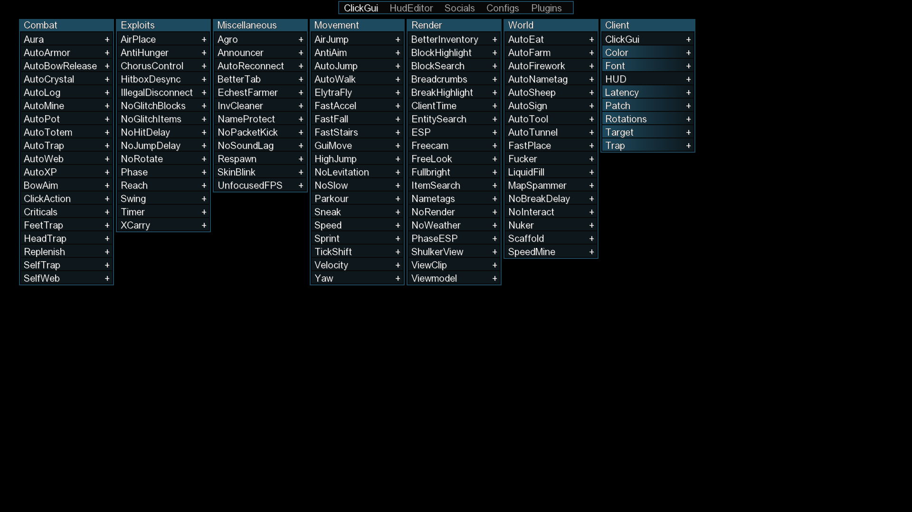
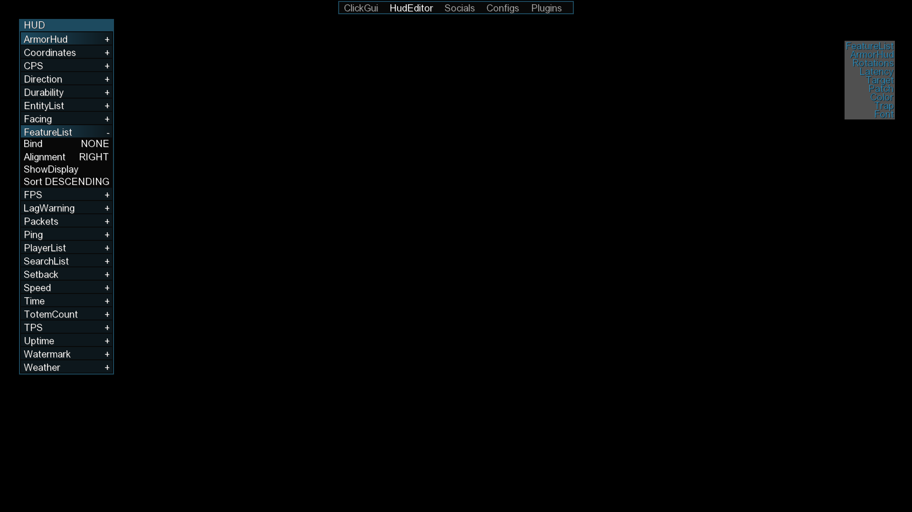
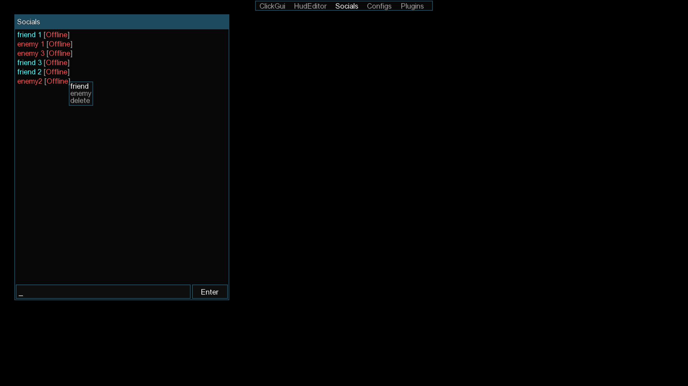
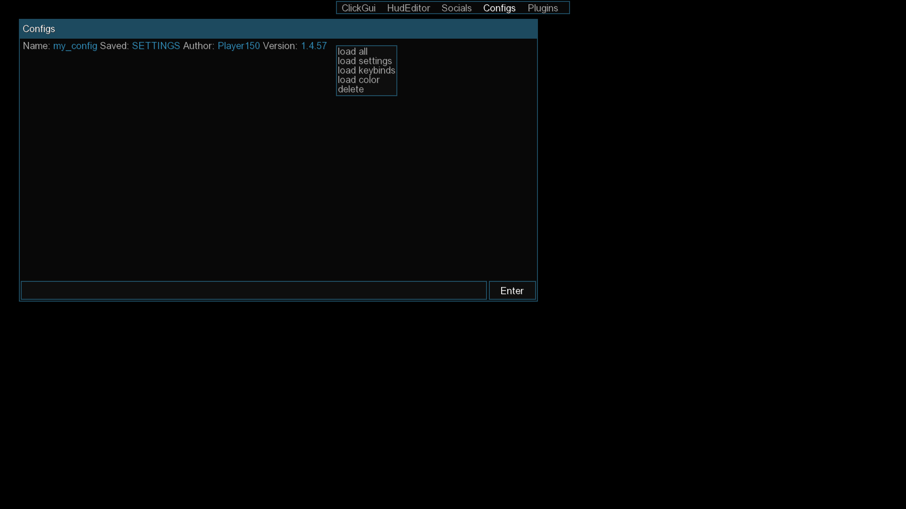

# Insta

This is a rebranded build based on the last public client release for Minecraft 1.21.11.
It won't receive any updates.


**Insta** is a modular and lightweight anarchy client base built for PVE and automation.

Most popular Minecraft clients are closed-source, paid, and obfuscated, making them difficult to audit or trust. Some may include backdoors or malicious code.

This project started as a clean, open-source alternative aiming to be transparent, secure, and easy to extend without relying on unsafe third-party clients.

---

## Screenshots

<details>
<summary>View screenshots</summary>






</details>

---

## FAQ

<details>
<summary>How to open ClickGUI?</summary>

Default keybind is: P  

</details>

<details>
<summary>What is the command prefix?</summary>

The default command prefix is `-`.

</details>

---

## Requirements

- Java 21  
- Gradle 8+  
- Minecraft 1.21.11 
- Fabric loader, API

---

## How to Build

1. Configure your PAT token in the root `.gradle/gradle.properties` for the `insta-api` dependency.
2. Build from the repository root:

    ```bash
    ./gradlew build
    ```

The compiled JAR will be located at:  
`insta-client/build/libs/insta-<version>.jar`

The Insta JAR includes insta-api.

---

## License

Original Insta material owned by Deluxeg4 is all rights reserved. Use, copying,
modification, distribution, publication, sublicensing, and sale require prior
written permission.

This restriction does not revoke permissions already granted for Nami-derived
or other third-party code. See [THIRD_PARTY_LICENSES.md](THIRD_PARTY_LICENSES.md).

---

## Special Thanks

- [cattyngmd](https://github.com/cattyngmd)

- [CatFormat](https://github.com/cattyngmd/CatFormat)
